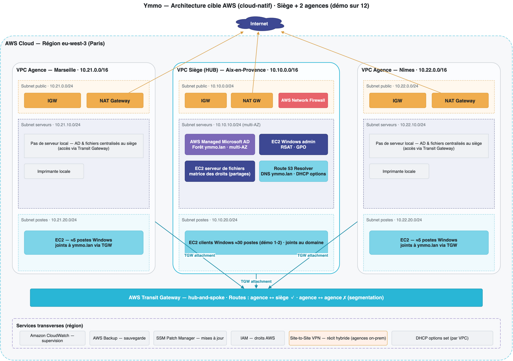

# Ymmo – Infrastructure AWS multi-sites en code

🇬🇧 [English version](README.md)

Le système d'information d'un groupe immobilier (siège + agences), construit **à 100 % en code** sur AWS : **Terraform** pour les ressources, **Ansible via SSM** pour la configuration des serveurs. Tout l'environnement se déploie depuis zéro avec un seul script, puis se détruit après usage pour garder un coût quasi nul. La démonstration couvre le siège et 2 agences (Marseille, Nîmes) ; l'architecture s'étend aux 12.

Projet fil rouge de Bachelor 2 (Ynov Toulouse).



## Construit couche par couche

| Étape | Ce qu'elle apporte | Doc |
|-------|--------------------|-----|
| **1 · Réseau** | Un VPC isolé par site, sous-réseaux public / serveurs / postes sur 2 AZ, sortie NAT, options DHCP | [PDF](steps/01-reseau/01-documentation.pdf) |
| **2 · Serveurs & annuaire** | Contrôleur de domaine `ymmo.lan`, OU par site, groupes par fonction, utilisateurs, le tout depuis un YAML source de vérité | [PDF](steps/02-compute-directory/02-documentation.pdf) |
| **3 · Hub-and-spoke** | **Transit Gateway** : siège ↔ agences autorisé, agence ↛ agence bloqué ; postes d'agence joints au domaine | [PDF](steps/03-interconnexion-hub-and-spoke/03-documentation.pdf) |
| **4 · Habilitations & serveur de fichiers** | Un partage SMB par pôle, droits NTFS pilotés par les groupes AD (matrice des droits), testés depuis une agence | [PDF](steps/04-habilitations-fileserver/04-documentation.pdf) |
| **5 · Accès nomade & pare-feu** | Passerelle **IPsec IKEv2** (strongSwan, EAP) pour les nomades, **AWS Network Firewall** avec filtrage de domaines et journaux | [PDF](steps/05-ipsec-firewall/05-documentation.pdf) |
| **6 · Sauvegarde & supervision** | Plan **AWS Backup** (données + annuaire), tableau de bord **CloudWatch**, alarmes et notifications SNS | [PDF](steps/06-backup-supervision/06-documentation.pdf) |

Synthèse globale : [synthese.pdf](synthese.pdf) · support de présentation de chaque étape dans `steps/<étape>/`.

## Sécurité dès la conception

- **Aucun port d'administration ouvert sur Internet** : pas d'IP publique sur les serveurs, tous les accès et toutes les exécutions Ansible passent par **AWS Systems Manager (SSM)**.
- **Segmentation** : un VPC par site, des sous-réseaux par rôle, des tables de routage Transit Gateway qui interdisent le trafic entre agences.
- **Moindre privilège** : l'identité de déploiement a des droits IAM restreints ; un script de **preflight IAM** simule chaque action nécessaire et s'arrête avant l'`apply` si l'une est refusée.
- **Aucun secret dans le dépôt** : le mot de passe administrateur du domaine et le secret VPN sont générés par Terraform ; le mot de passe des utilisateurs de démo et le bucket d'état viennent de variables d'environnement.
- **État Terraform distant chiffré** sur S3, avec verrou natif.

## Déployer

Prérequis : Terraform ≥ 1.10, AWS CLI v2, plugin Session Manager, Ansible avec `boto3`. Détails dans [infra/README.md](infra/README.md).

```bash
cd infra
export AWS_PROFILE=<votre-profil>
export TF_STATE_BUCKET=<bucket-s3-existant>
export AD_DEMO_PASSWORD='<mot de passe respectant la complexité AD>'
./deploy-all.sh        # ~20–25 min : apply → promotion du DC → objets AD → jonctions → partages → VPN
```

Détruire : `terraform -chdir=terraform/environments/demo destroy`.

## Organisation du dépôt

```
.
├── infra/
│   ├── terraform/       modules/network + environments/demo (VPC, EC2, Transit Gateway, VPN, Network Firewall, Backup, CloudWatch)
│   ├── ansible/         playbooks via SSM : promotion du DC, objets AD, jonctions, partages, strongSwan
│   └── deploy-all.sh    orchestrateur unique avec vérification des dépendances
├── steps/               documentation (PDF/DOCX), présentations (PDF/PPTX) et schémas (draw.io + PNG) par étape
├── schemas/             architecture cible
├── docs/notes/          notes techniques : DNS & AD, poste vs utilisateur, hub-and-spoke, estimation des coûts
├── .generator/          docs-as-code : contenu YAML + modèles → livrables Word et PowerPoint
├── USERS.md             annuaire de démo (utilisateurs, groupes, partages)
└── CONNEXION.md         comment accéder à chaque machine via SSM
```

## Limites connues

- Le routage de la sortie Internet à travers le Network Firewall n'est pas encore câblé : le pare-feu et ses règles sont déployés, la redirection du trafic reste à faire.
- Seule la sortie du siège est inspectée ; les agences gardent leur propre NAT.
