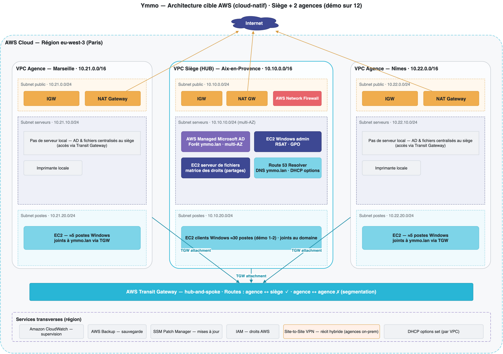

# Ymmo – Multi-site AWS Infrastructure as Code


🇫🇷 [Version française](README.fr.md) · the detailed documentation and slides are in French.

The IT system of a real-estate group (head office + branches), built **100% as code** on AWS: **Terraform** for the resources, **Ansible over SSM** for server configuration. The whole environment deploys from scratch with one script and is destroyed after use to keep costs near zero. The demo covers the head office and 2 branches (Marseille, Nîmes); the design scales to all 12.

Bachelor year 2 capstone project (Ynov Toulouse).



## Built layer by layer

| Step | What it delivers | Docs |
|------|------------------|------|
| **1 · Network** | One isolated VPC per site, public / server / workstation subnets on 2 AZs, NAT egress, DHCP options | [PDF](steps/01-reseau/01-documentation.pdf) |
| **2 · Servers & directory** | Domain controller `ymmo.lan`, OUs by site, groups by function, users — all from a YAML source of truth | [PDF](steps/02-compute-directory/02-documentation.pdf) |
| **3 · Hub-and-spoke** | **Transit Gateway**: head office ↔ branches allowed, branch ↛ branch blocked; branch workstations joined to the domain | [PDF](steps/03-interconnexion-hub-and-spoke/03-documentation.pdf) |
| **4 · Access rights & file server** | One SMB share per department, NTFS rights driven by AD groups (access matrix), tested from a branch | [PDF](steps/04-habilitations-fileserver/04-documentation.pdf) |
| **5 · Remote access & firewall** | **IPsec IKEv2** gateway (strongSwan, EAP) for mobile users, **AWS Network Firewall** with domain filtering and logs | [PDF](steps/05-ipsec-firewall/05-documentation.pdf) |
| **6 · Backup & monitoring** | **AWS Backup** plan (data + directory), **CloudWatch** dashboard, alarms and SNS notifications | [PDF](steps/06-backup-supervision/06-documentation.pdf) |

Overall summary: [synthese.pdf](synthese.pdf) · slides for each step in `steps/<step>/`.

## Security by design

- **No administration port open to the Internet**: no public IP on servers, all access and all Ansible runs go through **AWS Systems Manager (SSM)**.
- **Segmentation**: one VPC per site, separate subnets per role, Transit Gateway route tables that forbid branch-to-branch traffic.
- **Least privilege**: the deployment identity has restricted IAM permissions; an IAM **preflight** script simulates every required action and stops before `apply` if one is denied.
- **No secrets in the repository**: the domain admin password and the VPN secret are generated by Terraform; the demo user password and the state bucket come from environment variables.
- **Encrypted remote state** on S3 with native locking.

## Deploy

Prerequisites: Terraform ≥ 1.10, AWS CLI v2, Session Manager plugin, Ansible with `boto3`. Details in [infra/README.md](infra/README.md).

```bash
cd infra
export AWS_PROFILE=<your-profile>
export TF_STATE_BUCKET=<existing-s3-bucket>
export AD_DEMO_PASSWORD='<password meeting AD complexity rules>'
./deploy-all.sh        # ~20–25 min: apply → DC promotion → AD objects → domain joins → file shares → VPN
```

Destroy: `terraform -chdir=terraform/environments/demo destroy`.

## Repository layout

```
.
├── infra/
│   ├── terraform/       modules/network + environments/demo (VPC, EC2, Transit Gateway, VPN, Network Firewall, Backup, CloudWatch)
│   ├── ansible/         playbooks over SSM: DC promotion, AD objects, domain joins, file shares, strongSwan
│   └── deploy-all.sh    one-shot orchestrator with dependency preflight
├── steps/               per-step documentation (PDF/DOCX), slides (PDF/PPTX) and diagrams (draw.io + PNG)
├── schemas/             target architecture
├── docs/notes/          technical notes: DNS & AD, workstation vs user, hub-and-spoke, cost estimate
├── .generator/          docs-as-code: YAML content + templates → Word and PowerPoint deliverables
├── USERS.md             demo directory (users, groups, shares)
└── CONNEXION.md         how to reach each machine through SSM
```

## Known limits

- Egress routing through the Network Firewall endpoint is not yet wired: the firewall and its rules are deployed, traffic redirection is the remaining step.
- Only the head office egress is inspected; branches keep their own NAT.
